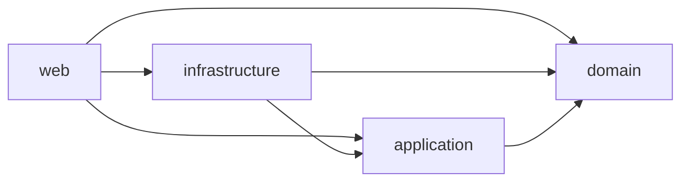

# Pokéfolio

[](https://github.com/miguelgutierrezi/pokemon-app/actions/workflows/ci.yml)

Pokéfolio is a Clean Architecture Pokemon portfolio app (Spring Boot + React) built for the Ballast Lane technical exercise. The backend exposes a paginated National Dex list and Pokémon detail via PokeAPI, plus a local collection sync API; the catalog UI lands in feature **007**. See [docs/requirements.md](docs/requirements.md).

## Architecture

Backend modules (Maven), dependencies only inward:



| Module | Role |
|---|---|
| `domain` | Business types; no framework deps |
| `application` | Use cases and ports |
| `infrastructure` | Adapters (DB/Flyway, PokeAPI + Caffeine) |
| `web` | Spring Boot entrypoint, HTTP, Actuator, OpenAPI |

**Coverage:** JaCoCo enforces **≥ 80% line coverage per module** on `verify` (each module must cover its own code). After `./mvnw -B -pl web -am verify`, an optional aggregate HTML report is at `backend/web/target/site/jacoco-aggregate/index.html` (visibility only — not a gate). Only `PokemonApplication` is excluded (bootstrap `main` is never run by tests).

Frontend: Vite + React 19 + TypeScript + Tailwind v4 under `frontend/`. Nginx serves the SPA and proxies `/api/` to the backend without rewriting the path. Catalog UI coming in **007**.

## Prerequisites

- Docker + Compose v2
- JDK 21 (local backend)
- Node 24 (local frontend; see `frontend/.nvmrc`)
- jq (optional, used in curl examples)

## Run with Docker

```bash
cp .env.example .env
docker compose up --build
```

- UI: http://localhost:3000
- Health: http://localhost:8080/actuator/health
- List API: http://localhost:8080/api/v1/pokemon
- Detail API: http://localhost:8080/api/v1/pokemon/1
- Collection API: http://localhost:8080/api/v1/collection
- Swagger UI: http://localhost:8080/swagger-ui/index.html
- OpenAPI JSON: http://localhost:8080/v3/api-docs

Tear down: `docker compose down -v`.

## API

### List

`GET /api/v1/pokemon?page=&size=`

| Query | Default | Constraints |
|---|---|---|
| `page` | `1` | ≥ 1 |
| `size` | `9` | 1–20 |

Example (`page=1`, `size=9`):

```json
{
  "content": [
    {
      "nationalNumber": 1,
      "name": "Bulbasaur",
      "spriteUrl": "https://raw.githubusercontent.com/PokeAPI/sprites/master/sprites/pokemon/1.png",
      "category": "Seed Pokémon",
      "weightKg": 6.9,
      "abilities": [
        { "name": "overgrow", "hidden": false },
        { "name": "chlorophyll", "hidden": true }
      ]
    }
  ],
  "page": 1,
  "size": 9,
  "totalElements": 1025,
  "totalPages": 114
}
```

| Status | When |
|---|---|
| `400` | Invalid paging (Bean Validation or page beyond last) |
| `502` | Upstream catalog unavailable or timed out |

### Detail

`GET /api/v1/pokemon/{id}` — National Dex id (`id` ≥ 1).

`imageUrl` prefers official artwork (falls back to the front sprite). Evolution
tree node `imageUrl` values are front sprites only (thumbnails), not artwork.

Trimmed example (`GET /api/v1/pokemon/1`):

```json
{
  "nationalNumber": 1,
  "name": "Bulbasaur",
  "category": "Seed Pokémon",
  "types": ["grass", "poison"],
  "heightM": 0.7,
  "weightKg": 6.9,
  "abilities": [
    { "name": "overgrow", "hidden": false },
    { "name": "chlorophyll", "hidden": true }
  ],
  "generation": "generation-i",
  "imageUrl": "https://raw.githubusercontent.com/PokeAPI/sprites/master/sprites/pokemon/other/official-artwork/1.png",
  "stats": {
    "hp": 45,
    "attack": 49,
    "defense": 49,
    "specialAttack": 65,
    "specialDefense": 65,
    "speed": 45,
    "total": 318
  },
  "flavorText": {
    "text": "A strange seed was planted on its back at birth. The plant sprouts and grows with this Pokémon.",
    "version": "red"
  },
  "evolution": {
    "nationalNumber": 1,
    "name": "Bulbasaur",
    "imageUrl": "https://raw.githubusercontent.com/PokeAPI/sprites/master/sprites/pokemon/1.png",
    "isCurrent": true,
    "children": [
      {
        "trigger": "level-up",
        "minLevel": 16,
        "itemSlug": null,
        "node": {
          "nationalNumber": 2,
          "name": "Ivysaur",
          "imageUrl": "https://raw.githubusercontent.com/PokeAPI/sprites/master/sprites/pokemon/2.png",
          "isCurrent": false,
          "children": []
        }
      }
    ]
  }
}
```

| Status | When |
|---|---|
| `400` | Invalid id (non-numeric or &lt; 1) |
| `404` | Pokémon not found in the catalog |
| `502` | Upstream catalog unavailable or timed out |

### Collection

Local collection (import from the catalog, read, update proprietary fields,
delete). Same paging rules as the list endpoint (`page` default `1`, `size`
default `9`, max `20`). Every collection response that returns a local record
(import, list item, get, update) includes an optimistic-lock **`version`**
(integer ≥ 0; `0` after import/seed; increments on each successful update).

> **Temporary exception to constitution VI:** write routes (`POST` import,
> `PUT` update, `DELETE`) are **public** and the store is **global** (one
> shared collection) until feature **006** adds JWT and per-user scoping. Do
> not treat this as the final security model.

#### Import

`POST /api/v1/collection` with JSON body `{"nationalNumber": n}` (`n` ≥ 1).

```bash
curl -sS -D - -o /tmp/collection-import.json \
  -H 'Content-Type: application/json' \
  -d '{"nationalNumber":25}' \
  http://localhost:8080/api/v1/collection
```

On success: **201 Created**, `Location: /api/v1/collection/{n}`, body is the
local record with **`version`: 0** (catalog snapshot; `localizedName` /
`location` null and `tags` empty until edited).

| Status | When |
|---|---|
| `400` | Missing/invalid body (`nationalNumber`), or unknown JSON property |
| `404` | Pokémon not found in the **catalog** |
| `409` | National number already in the local collection (`type`: `urn:problem-type:conflict`) |
| `502` | Upstream catalog unavailable or timed out |

#### List local collection

`GET /api/v1/collection?page=&size=` — same pagination envelope as the catalog
list (`content`, `page`, `size`, `totalElements`, `totalPages`); items are
local records (each includes **`version`**).

```bash
curl -sS 'http://localhost:8080/api/v1/collection?page=1&size=9' | jq .
```

| Status | When |
|---|---|
| `400` | Invalid paging (Bean Validation or page beyond last) |

#### Get one local record

`GET /api/v1/collection/{nationalNumber}` (`nationalNumber` ≥ 1). Response
includes **`version`** (use it as the expected concurrency token on `PUT`).

```bash
curl -sS http://localhost:8080/api/v1/collection/1 | jq .
```

| Status | When |
|---|---|
| `400` | Invalid `nationalNumber` (non-numeric or &lt; 1) |
| `404` | Not in the **local** collection (detail: `Pokémon {n} is not in the local collection` — distinct from catalog 404) |

#### Update proprietary fields

`PUT /api/v1/collection/{nationalNumber}` with `Content-Type: application/json`.
The body **must** include all four properties (omit → 400); explicit `null`
clears text fields; `tags: []` clears tags (`tags: null` → 400). Send
`version` from the last GET.

```bash
# read current version
VERSION=$(curl -sS http://localhost:8080/api/v1/collection/1 | jq -r .version)

curl -sS -D - -o /tmp/collection-update.json \
  -X PUT \
  -H 'Content-Type: application/json' \
  -d "{\"localizedName\":\"Bulbizarre\",\"location\":\"Pallet Town garden\",\"tags\":[\"garden\",\"notes\"],\"version\":${VERSION}}" \
  http://localhost:8080/api/v1/collection/1
```

On success: **200 OK** with the updated record and **`version` incremented**.
Snapshot fields (`name`, `types`, `syncedAt`, …) are read-only — sending them
(or any unknown property) → **400**.

Clear proprietary fields:

```bash
VERSION=$(curl -sS http://localhost:8080/api/v1/collection/1 | jq -r .version)
curl -sS -X PUT -H 'Content-Type: application/json' \
  -d "{\"localizedName\":null,\"location\":null,\"tags\":[],\"version\":${VERSION}}" \
  http://localhost:8080/api/v1/collection/1 | jq '{localizedName,location,tags,version}'
```

| Status | When |
|---|---|
| `400` | Missing property, wrong types, limits, blank tag, unknown/read-only property (detail names the field, e.g. `Unknown or read-only property 'name'`, `Invalid or missing value for property 'version'`) |
| `404` | Not in the **local** collection (same wording as GET) |
| `409` | Stale `version` (`type`: `urn:problem-type:stale-version`; detail: `Pokémon {n} was modified by another request; reload and retry`) — distinct from duplicate-import `conflict` |
| `415` | Non-JSON `Content-Type` |

Stale-version example (reuse an old token after a successful update):

```bash
curl -sS -D - -o /tmp/collection-stale.json \
  -X PUT \
  -H 'Content-Type: application/json' \
  -d '{"localizedName":"X","location":null,"tags":[],"version":0}' \
  http://localhost:8080/api/v1/collection/1
```

Unknown / read-only snapshot field → **400**:

```bash
VERSION=$(curl -sS http://localhost:8080/api/v1/collection/1 | jq -r .version)
curl -sS -D - -o /tmp/collection-unknown.json \
  -X PUT \
  -H 'Content-Type: application/json' \
  -d "{\"localizedName\":null,\"location\":null,\"tags\":[],\"version\":${VERSION},\"name\":\"Hack\"}" \
  http://localhost:8080/api/v1/collection/1
```

Non-JSON → **415**:

```bash
curl -sS -D - -o /tmp/collection-415.json \
  -X PUT \
  -H 'Content-Type: text/plain' \
  -d 'nope' \
  http://localhost:8080/api/v1/collection/1
```

#### Delete a local record

`DELETE /api/v1/collection/{nationalNumber}` — removes the local row only
(catalog untouched). Success: **204 No Content** (empty body).

```bash
curl -sS -D - -o /dev/null -X DELETE http://localhost:8080/api/v1/collection/25
```

| Status | When |
|---|---|
| `400` | Invalid `nationalNumber` |
| `404` | Not in the **local** collection (same wording as GET) |

#### Seeded demo rows

After `docker compose up`, Flyway seeds three local rows (French localized
names; each starts at **`version` 0**):

| # | Name | Localized | Location | Tags |
|---|---|---|---|---|
| 1 | Bulbasaur | Bulbizarre | Pallet Town garden | first-partner, forest |
| 2 | Ivysaur | Herbizarre | Route 1 tall grass | field-notes, forest |
| 3 | Venusaur | Florizarre | Viridian Forest clearing | first-partner, field-notes |

Errors use RFC 7807 `application/problem+json`.

Nginx at http://localhost:3000 proxies `/api/` unchanged (same paths).

OpenAPI: [Swagger UI](http://localhost:8080/swagger-ui/index.html) · raw [`/v3/api-docs`](http://localhost:8080/v3/api-docs) (paths `/api/v1/pokemon`, `/api/v1/pokemon/{id}`, and `/api/v1/collection`).

## Configuration

| Variable | Default | Role |
|---|---|---|
| `POSTGRES_*` | see `.env.example` | Database (required in Compose) |
| `POKEAPI_BASE_URL` | `https://pokeapi.co/api/v2` | PokeAPI base for the catalog client |

Catalog responses are cached in memory with **Caffeine** (default TTL **24h**, configurable via `pokemonapp.pokeapi.cache.*` in `application.yml`). Failures are never cached.

## Run locally

```bash
cp .env.example .env
docker compose up -d postgres

cd backend
set -a; . ../.env; set +a
export SPRING_DATASOURCE_USERNAME="$POSTGRES_USER" SPRING_DATASOURCE_PASSWORD="$POSTGRES_PASSWORD"
./mvnw -B install -DskipTests
./mvnw -pl web spring-boot:run
```

```bash
cd frontend
npm ci
npm run dev
```

Backend: http://localhost:8080 — Frontend Vite: http://localhost:5173.

## Tests

```bash
cd backend && ./mvnw -B verify
```

```bash
cd frontend
npm ci
npm run lint
npm run typecheck
npm test
npm run build
```

## CI/CD

Workflow: [`.github/workflows/ci.yml`](.github/workflows/ci.yml)

| Job | When | What |
|---|---|---|
| `changes` | every run | Path filter for `backend` / `frontend` |
| `backend` | backend paths | `./mvnw -B verify`, then `docker build backend` |
| `frontend` | frontend paths | lint, typecheck, test, build, `docker build frontend` + smoke |
| `publish` | push to `main` only | push both images to GHCR (`:sha` and `:latest`) |

Images (lowercase owner):

- `ghcr.io/miguelgutierrezi/pokemonapp-backend`
- `ghcr.io/miguelgutierrezi/pokemonapp-frontend`

PRs never publish.

## Project workflow

Features are specified with Spec Kit under `specs/<nnn>-<name>/` (constitution in `.specify/memory/constitution.md`). One branch and one PR per feature; keep CI green on the draft PR.
