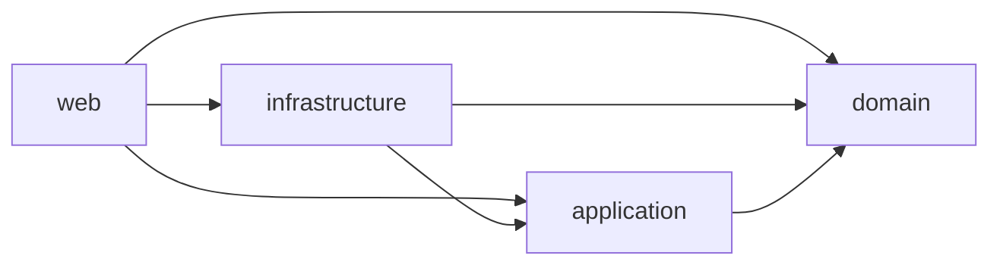

# Pokéfolio

[](https://github.com/miguelgutierrezi/pokemon-app/actions/workflows/ci.yml)

Pokéfolio is a Clean Architecture Pokemon portfolio app (Spring Boot + React) built for the Ballast Lane technical exercise. This repository currently contains the **001-setup** skeleton: a bootable backend with Actuator health and a Flyway baseline, a placeholder React UI, Docker Compose, and CI that verifies both sides and publishes images to GHCR on `main`. Full product behavior (PokeAPI sync, auth, UI features) comes in features **002–007**. See [docs/requirements.md](docs/requirements.md).

## Architecture

Backend modules (Maven), dependencies only inward:



| Module | Role |
|---|---|
| `domain` | Business types; no framework deps |
| `application` | Use cases and ports |
| `infrastructure` | Adapters (DB/Flyway today; PokeAPI later) |
| `web` | Spring Boot entrypoint, HTTP, Actuator |

**Coverage (research R6):** JaCoCo enforces **≥ 80% line coverage per module** on `verify`. Each module must test its own code (web ITs do not raise `infrastructure` coverage). Only `PokemonApplication` is excluded (bootstrap `main` is never run by tests).

Frontend: Vite + React 19 + TypeScript + Tailwind v4 under `frontend/`. Nginx serves the SPA and proxies `/api/` to the backend without rewriting the path.

## Prerequisites

- Docker + Compose v2
- JDK 21 (local backend)
- Node 24 (local frontend; see `frontend/.nvmrc`)

## Run with Docker

```bash
cp .env.example .env
docker compose up --build
```

- UI: http://localhost:3000
- Health: http://localhost:8080/actuator/health

Tear down: `docker compose down -v`.

## Run locally

```bash
cp .env.example .env
docker compose up -d postgres

cd backend
set -a; . ../.env; set +a
export SPRING_DATASOURCE_USERNAME="$POSTGRES_USER" SPRING_DATASOURCE_PASSWORD="$POSTGRES_PASSWORD"
./mvnw -B install -DskipTests
./mvnw -pl web spring-boot:run
```

```bash
cd frontend
npm ci
npm run dev
```

Backend: http://localhost:8080 — Frontend Vite: http://localhost:5173.

## Tests

```bash
cd backend && ./mvnw -B verify
```

```bash
cd frontend
npm ci
npm run lint
npm run typecheck
npm test
npm run build
```

## CI/CD

Workflow: [`.github/workflows/ci.yml`](.github/workflows/ci.yml)

| Job | When | What |
|---|---|---|
| `changes` | every run | Path filter for `backend` / `frontend` |
| `backend` | backend paths | `./mvnw -B verify`, then `docker build backend` |
| `frontend` | frontend paths | lint, typecheck, test, build, `docker build frontend` + smoke |
| `publish` | push to `main` only | push both images to GHCR (`:sha` and `:latest`) |

Images (lowercase owner):

- `ghcr.io/miguelgutierrezi/pokemonapp-backend`
- `ghcr.io/miguelgutierrezi/pokemonapp-frontend`

PRs never publish.

## Project workflow

Features are specified with Spec Kit under `specs/<nnn>-<name>/` (constitution in `.specify/memory/constitution.md`). One branch and one PR per feature; keep CI green on the draft PR.
