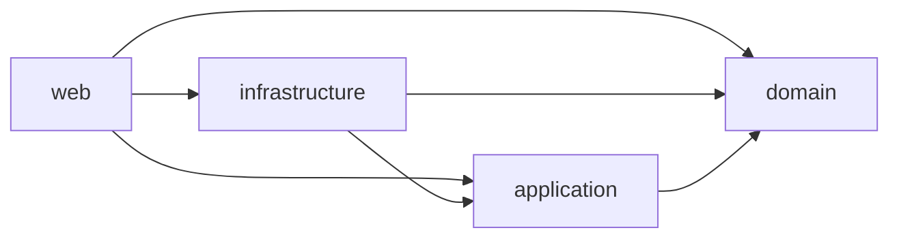

# Pokéfolio

[](https://github.com/miguelgutierrezi/pokemon-app/actions/workflows/ci.yml)

Pokéfolio is a Clean Architecture Pokemon portfolio app (Spring Boot + React) built for the Ballast Lane technical exercise. The backend exposes a paginated National Dex list and Pokémon detail via PokeAPI; the catalog UI lands in feature **007**. See [docs/requirements.md](docs/requirements.md).

## Architecture

Backend modules (Maven), dependencies only inward:



| Module | Role |
|---|---|
| `domain` | Business types; no framework deps |
| `application` | Use cases and ports |
| `infrastructure` | Adapters (DB/Flyway, PokeAPI + Caffeine) |
| `web` | Spring Boot entrypoint, HTTP, Actuator, OpenAPI |

**Coverage:** JaCoCo enforces **≥ 80% line coverage per module** on `verify` (each module must cover its own code). After `./mvnw -B -pl web -am verify`, an optional aggregate HTML report is at `backend/web/target/site/jacoco-aggregate/index.html` (visibility only — not a gate). Only `PokemonApplication` is excluded (bootstrap `main` is never run by tests).

Frontend: Vite + React 19 + TypeScript + Tailwind v4 under `frontend/`. Nginx serves the SPA and proxies `/api/` to the backend without rewriting the path. Catalog UI coming in **007**.

## Prerequisites

- Docker + Compose v2
- JDK 21 (local backend)
- Node 24 (local frontend; see `frontend/.nvmrc`)

## Run with Docker

```bash
cp .env.example .env
docker compose up --build
```

- UI: http://localhost:3000
- Health: http://localhost:8080/actuator/health
- List API: http://localhost:8080/api/v1/pokemon
- Detail API: http://localhost:8080/api/v1/pokemon/1
- Swagger UI: http://localhost:8080/swagger-ui/index.html
- OpenAPI JSON: http://localhost:8080/v3/api-docs

Tear down: `docker compose down -v`.

## API

### List

`GET /api/v1/pokemon?page=&size=`

| Query | Default | Constraints |
|---|---|---|
| `page` | `1` | ≥ 1 |
| `size` | `9` | 1–20 |

Example (`page=1`, `size=9`):

```json
{
  "content": [
    {
      "nationalNumber": 1,
      "name": "Bulbasaur",
      "spriteUrl": "https://raw.githubusercontent.com/PokeAPI/sprites/master/sprites/pokemon/1.png",
      "category": "Seed Pokémon",
      "weightKg": 6.9,
      "abilities": [
        { "name": "overgrow", "hidden": false },
        { "name": "chlorophyll", "hidden": true }
      ]
    }
  ],
  "page": 1,
  "size": 9,
  "totalElements": 1025,
  "totalPages": 114
}
```

| Status | When |
|---|---|
| `400` | Invalid paging (Bean Validation or page beyond last) |
| `502` | Upstream catalog unavailable or timed out |

### Detail

`GET /api/v1/pokemon/{id}` — National Dex id (`id` ≥ 1).

`imageUrl` prefers official artwork (falls back to the front sprite). Evolution
tree node `imageUrl` values are front sprites only (thumbnails), not artwork.

Trimmed example (`GET /api/v1/pokemon/1`):

```json
{
  "nationalNumber": 1,
  "name": "Bulbasaur",
  "category": "Seed Pokémon",
  "types": ["grass", "poison"],
  "heightM": 0.7,
  "weightKg": 6.9,
  "abilities": [
    { "name": "overgrow", "hidden": false },
    { "name": "chlorophyll", "hidden": true }
  ],
  "generation": "generation-i",
  "imageUrl": "https://raw.githubusercontent.com/PokeAPI/sprites/master/sprites/pokemon/other/official-artwork/1.png",
  "stats": {
    "hp": 45,
    "attack": 49,
    "defense": 49,
    "specialAttack": 65,
    "specialDefense": 65,
    "speed": 45,
    "total": 318
  },
  "flavorText": {
    "text": "A strange seed was planted on its back at birth. The plant sprouts and grows with this Pokémon.",
    "version": "red"
  },
  "evolution": {
    "nationalNumber": 1,
    "name": "Bulbasaur",
    "imageUrl": "https://raw.githubusercontent.com/PokeAPI/sprites/master/sprites/pokemon/1.png",
    "isCurrent": true,
    "children": [
      {
        "trigger": "level-up",
        "minLevel": 16,
        "itemSlug": null,
        "node": {
          "nationalNumber": 2,
          "name": "Ivysaur",
          "imageUrl": "https://raw.githubusercontent.com/PokeAPI/sprites/master/sprites/pokemon/2.png",
          "isCurrent": false,
          "children": []
        }
      }
    ]
  }
}
```

| Status | When |
|---|---|
| `400` | Invalid id (non-numeric or &lt; 1) |
| `404` | Pokémon not found in the catalog |
| `502` | Upstream catalog unavailable or timed out |

Errors on both endpoints use RFC 7807 `application/problem+json`.

Nginx at http://localhost:3000 proxies `/api/` unchanged (same paths).

OpenAPI: [Swagger UI](http://localhost:8080/swagger-ui/index.html) · raw [`/v3/api-docs`](http://localhost:8080/v3/api-docs) (paths `/api/v1/pokemon` and `/api/v1/pokemon/{id}`).

## Configuration

| Variable | Default | Role |
|---|---|---|
| `POSTGRES_*` | see `.env.example` | Database (required in Compose) |
| `POKEAPI_BASE_URL` | `https://pokeapi.co/api/v2` | PokeAPI base for the catalog client |

Catalog responses are cached in memory with **Caffeine** (default TTL **24h**, configurable via `pokemonapp.pokeapi.cache.*` in `application.yml`). Failures are never cached.

## Run locally

```bash
cp .env.example .env
docker compose up -d postgres

cd backend
set -a; . ../.env; set +a
export SPRING_DATASOURCE_USERNAME="$POSTGRES_USER" SPRING_DATASOURCE_PASSWORD="$POSTGRES_PASSWORD"
./mvnw -B install -DskipTests
./mvnw -pl web spring-boot:run
```

```bash
cd frontend
npm ci
npm run dev
```

Backend: http://localhost:8080 — Frontend Vite: http://localhost:5173.

## Tests

```bash
cd backend && ./mvnw -B verify
```

```bash
cd frontend
npm ci
npm run lint
npm run typecheck
npm test
npm run build
```

## CI/CD

Workflow: [`.github/workflows/ci.yml`](.github/workflows/ci.yml)

| Job | When | What |
|---|---|---|
| `changes` | every run | Path filter for `backend` / `frontend` |
| `backend` | backend paths | `./mvnw -B verify`, then `docker build backend` |
| `frontend` | frontend paths | lint, typecheck, test, build, `docker build frontend` + smoke |
| `publish` | push to `main` only | push both images to GHCR (`:sha` and `:latest`) |

Images (lowercase owner):

- `ghcr.io/miguelgutierrezi/pokemonapp-backend`
- `ghcr.io/miguelgutierrezi/pokemonapp-frontend`

PRs never publish.

## Project workflow

Features are specified with Spec Kit under `specs/<nnn>-<name>/` (constitution in `.specify/memory/constitution.md`). One branch and one PR per feature; keep CI green on the draft PR.
